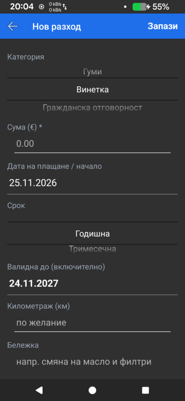
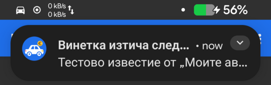

<p align="center">
  
</p>

<h1 align="center">Моята кола</h1>

<p align="center">
  Мобилно приложение за записване на разходите по личните автомобили, обслужването и сроковете на винетка, гражданска отговорност и технически преглед.<br/>
  Написано на <a href="https://nativescript.org/">NativeScript</a> (TypeScript).
</p>

---

## Възможности

- **Няколко автомобила.** Марка и модел, регистрационен номер; общо похарчено и брой разходи за всеки.
- **Разходи по категории:** гориво, обслужване, ремонт, гуми, винетка, гражданска отговорност, технически преглед, каско, данък, паркинг, измиване, глоба и друго.
- **Обобщение за всяка кола:** общо, за текущата година, по категории и **среден разход на гориво (л/100 км)**. Разходът на гориво се изчислява от литрите и километража при зарежданията.
- **Обслужване – кога какво е сменено.** При разход за обслужване, ремонт или гуми се отмятат сменените части (масло, филтри, ангренаж, накладки, дискове, течности, акумулатор, гуми и др.). Екранът „Обслужване“ показва за всяка част кога и на колко километра е сменена и кога е следващата смяна (по км или по време):
  - 🔴 просрочено
  - 🟠 наближава (под 1000 км или под 1 месец)
  - 🟢 наред

  Интервалите имат стойности по подразбиране и се настройват за всяка кола.
- **Документи със срок:** винетка (годишна, тримесечна, месечна, седмична, уикенд), гражданска отговорност, технически преглед и каско. „Валидна до“ се изчислява автоматично от датата и срока, но може да се промени ръчно. Изтичащите документи се виждат още в списъка с колите.
- **Известия преди изтичане:** 30, 7 и 1 ден преди и в деня на изтичане, в 10:00. Работят и при затворено приложение, а след рестарт на телефона се възстановяват.
- **Тъмен режим** и стандартен календар на Android за избор на дата.
- **Данните остават на телефона.** Няма сървър, регистрация или нужда от интернет.

## Екрани

| Автомобили | Кола | Разходи |
|:---:|:---:|:---:|
|  |  |  |
| **Обслужване** | **Винетка / документ** | **Известие** |
|  |  |  |

> Снимките са направени с демо данни.

## Стартиране

Нужни са [Node.js](https://nodejs.org/), [NativeScript CLI](https://docs.nativescript.org/setup/) и Android SDK (или Xcode за iOS).

```bash
npm install
ns run android          # на свързан телефон или емулатор
ns build android        # APK в platforms/android/app/build/outputs/apk/
```

Приложението е пробвано на Android. iOS ресурсите (икона, име) са подготвени, но не е пускано на iPhone.

## Структура

```
app/
  app.ts                 входна точка; пренарежда известията при промяна на данните
  app.css                стилове (вкл. тъмен режим)
  data/
    store.ts             данни (ApplicationSettings), категории, обслужване, документи
    notify.ts            планиране на известията за изтичащи документи
    demo.ts              демо данни за изпробване (меню „⋮“)
  pages/
    cars-page.*          списък с автомобили
    car-page.*           обобщение и разходи за кола
    expense-page.*       добавяне / редакция на разход
    service-page.*       обслужване – кога какво е сменено
    car-dialog.ts        добавяне / редакция на кола
App_Resources/           икони, име, Android / iOS настройки
```

## Бележки

- Данните се пазят в `ApplicationSettings` (SharedPreferences на Android) и се изтриват при деинсталиране на приложението.
- Известията използват [`@nativescript/local-notifications`](https://github.com/NativeScript/plugins/tree/main/packages/local-notifications). Android може да ги забави с до около час, за да пести батерия.
- Менюто „⋮“ показва броя планирани известия, пуска тестово известие и добавя или изтрива демо данни. Изтриват се само демо записите.
