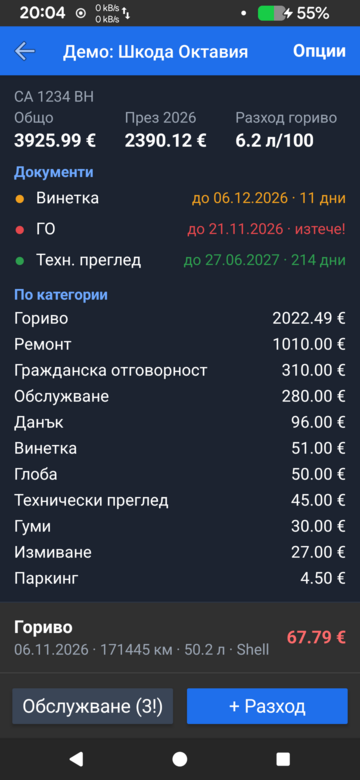
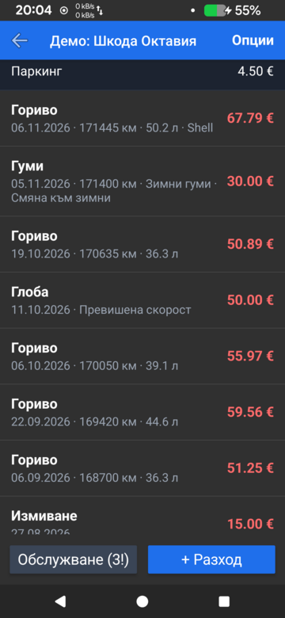
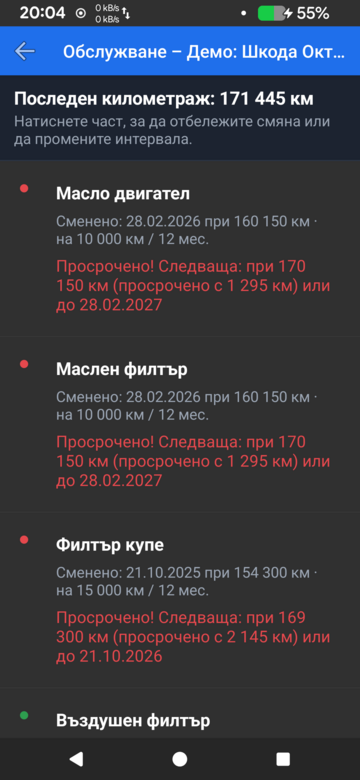

<p align="center">
  
</p>

<h1 align="center">Моята кола</h1>

<p align="center">
  <a href="https://github.com/Nanich87/my-car/actions/workflows/build.yml"></a>
</p>

<p align="center">
  Мобилно приложение за записване на разходите по личните автомобили, обслужването и сроковете на винетка, гражданска отговорност и технически преглед.<br/>
  Написано на <a href="https://nativescript.org/">NativeScript</a> (TypeScript).
</p>

---

## Възможности

- **Няколко автомобила.** Марка и модел, регистрационен номер; общо похарчено и брой разходи за всеки.
- **Разходи по категории:** гориво, обслужване, ремонт, гуми, винетка, гражданска отговорност, технически преглед, каско, данък, паркинг, измиване, глоба и друго.
- **Обобщение за всяка кола:** общо, за текущата година, по категории и **среден разход на гориво (л/100 км)**. Разходът на гориво се изчислява от литрите и километража при зарежданията.
- **Обслужване – кога какво е сменено.** При разход за обслужване, ремонт или гуми се отмятат сменените части (масло, филтри, ангренаж, накладки, дискове, течности, акумулатор, гуми и др.). Екранът „Обслужване“ показва за всяка част кога и на колко километра е сменена и кога е следващата смяна (по км или по време):
  - 🔴 просрочено
  - 🟠 наближава (под 1000 км или под 1 месец)
  - 🟢 наред

  Интервалите имат стойности по подразбиране и се настройват за всяка кола.

- **Документи със срок:** винетка (годишна, тримесечна, месечна, седмична, уикенд), гражданска отговорност, технически преглед и каско. „Валидна до“ се изчислява автоматично от датата и срока, но може да се промени ръчно. Изтичащите документи се виждат още в списъка с колите.
- **Известия преди изтичане:** 30, 7 и 1 ден преди и в деня на изтичане, в 10:00. Работят и при затворено приложение, а след рестарт на телефона се възстановяват.
- **Тъмен режим** и стандартен календар на Android за избор на дата.
- **Данните остават на телефона** в локална SQLite база. Няма сървър, регистрация или нужда от интернет.

## Екрани

|                                  Автомобили                                   |                                        Кола                                         |                                            Разходи                                             |
| :---------------------------------------------------------------------------: | :---------------------------------------------------------------------------------: | :--------------------------------------------------------------------------------------------: |
|  |           |                  |
|                                **Обслужване**                                 |                               **Винетка / документ**                                |                                          **Известие**                                          |
|        |  |  |

> Снимките са направени с демо данни.

## Стартиране

Нужни са [Node.js](https://nodejs.org/), [NativeScript CLI](https://docs.nativescript.org/setup/) и Android SDK (или Xcode за iOS).

```bash
npm install
ns run android          # на свързан телефон или емулатор
ns build android        # APK в platforms/android/app/build/outputs/apk/

npm run check           # типове, ESLint, Prettier и тестове
npm test                # само тестовете
npm run format          # форматиране с Prettier
```

При всеки push в `main` и при всеки pull request [GitHub Actions](.github/workflows/build.yml) проверява типовете, пуска ESLint, Prettier и тестовете и сглобява debug APK, който може да се изтегли от страницата на билда (раздел _Artifacts_).

Приложението е пробвано на Android. iOS ресурсите (икона, име) са подготвени, но не е пускано на iPhone.

## Структура

```
app/
  app.ts                 входна точка; пренарежда известията при промяна на данните
  app.css                стилове (вкл. тъмен режим)
  strings.ts             всички текстове на приложението (в XML: {{ t('car.total') }})
  data/
    model.ts             типове и константи (категории, документи, части за обслужване)
    logic.ts             изчисления без странични ефекти: срокове, разход на гориво, обслужване
    format.ts            форматиране за показване (1 234,56 €, 12.03.2027)
    db.ts                SQLite база: схема, миграции, транзакции
    store.ts             четене и записване на коли, разходи и интервали
    notify.ts            планиране на известията за изтичащи документи
  pages/
    cars-page.*          списък с автомобили
    car-page.*           обобщение и разходи за кола
    expense-page.*       добавяне / редакция на разход
    service-page.*       обслужване – кога какво е сменено
    car-dialog.ts        добавяне / редакция на кола
tests/                   тестове на logic.ts и format.ts (node --test)
App_Resources/           икони, име, Android / iOS настройки
```

## Бележки

- Данните се пазят в SQLite база `mycar.db` чрез [`@nativescript-community/sqlite`](https://github.com/nativescript-community/sqlite) и се изтриват при деинсталиране на приложението.
  - Таблиците са `cars`, `expenses`, `expense_parts` (сменените части) и `service_intervals`. При изтриване на кола изтриването е каскадно.
  - Категорията се пази като ключ (`fuel`, `vignette`…), а сумата – в центове (`amount_cents`), за да няма грешки от закръгляне.
  - Схемата се версионира с `PRAGMA user_version`: всяка промяна е нова функция в `MIGRATIONS` в `app/data/db.ts`, изпълнена в транзакция.
  - При първо стартиране данните от по-старите версии (пазени в `ApplicationSettings`) се прехвърлят автоматично.
  - Използват се синхронните заявки на плъгина, които изискват NativeScript 9.1 или по-нов.
- Известията използват [`@nativescript/local-notifications`](https://github.com/NativeScript/plugins/tree/main/packages/local-notifications). Android може да ги забави с до около час, за да пести батерия. Версията на плъгина е фиксирана, защото кодът заобикаля грешка в него чрез вътрешен му клас.
- Менюто „⋮“ показва броя планирани известия и пуска тестово известие.
